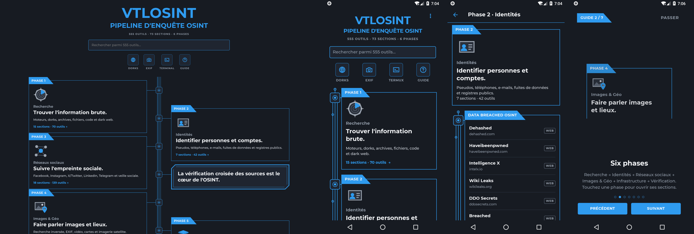

# VTLOsint

**Pipeline d'enquête OSINT** — plus de 550 outils OSINT rangés en six phases, sur Android et sur PC.

| Télécharger | Plateforme | Utilisation |
| --- | --- | --- |
| [`downloads/VTLOsint.apk`](downloads/VTLOsint.apk) | Android 8.0+ | Ouvrez le fichier sur le téléphone et autorisez l'installation. |
| [`downloads/VTLOsint-web.zip`](downloads/VTLOsint-web.zip) | PC (Windows, macOS, Linux) | Décompressez, puis ouvrez `VTLOsint-web/index.html` dans Chrome, Edge ou Firefox. |



## Les six phases

1. **Recherche** — moteurs, dorks, archives, fichiers, code et dark web.
2. **Identités** — pseudos, téléphones, e-mails, fuites de données, registres publics.
3. **Réseaux sociaux** — Facebook, Instagram, X/Twitter, LinkedIn, Telegram, veille sociale.
4. **Images & Géo** — recherche inversée, EXIF, vidéo, cartes, imagerie satellite.
5. **Infrastructure** — domaines, IP, IoT, menaces, serveurs, cryptomonnaies.
6. **Vérification & Arsenal** — fact-checking, frameworks OSINT, outils GitHub, communautés, articles.

Chaque phase regroupe des sections, chaque section liste ses outils :

- **WEB** — s'ouvre dans le navigateur (intégré sur Android, nouvel onglet sur PC).
- **>_ TERMINAL** — Sherlock, Maigret, GHunt, theHarvester… : commande d'installation prête à copier
  pour un terminal PC, ou lancement direct dans [Termux](https://f-droid.org/packages/com.termux/) sur Android.

Aussi inclus : recherche dans tous les outils, favoris, générateur de Google Dorks, lecteur/nettoyeur EXIF
(sans envoi de fichier) et un guide animé en français au premier lancement.

## Termux (Android)

1. Installez Termux depuis [F-Droid](https://f-droid.org/packages/com.termux/) et ouvrez-le une fois.
2. Dans Termux : `mkdir -p ~/.termux && echo 'allow-external-apps = true' >> ~/.termux/termux.properties && termux-reload-settings`
3. Android 10+ : autorisez Termux à s'afficher par-dessus les autres apps.
4. Accordez à VTLOsint la permission « Exécuter des commandes dans Termux » quand elle est demandée.

## Structure du projet

```
data/       tools.md, articles.md (la liste d'outils) et phases.json (classement en phases)
android/    application Android (Java, sans dépendance)
web/        application PC : src/ (sources), build.py, dist/ (version prête à l'emploi)
downloads/  APK et application PC prêts à télécharger
```

Pour ajouter un outil, éditez `data/tools.md` : une ligne `- [Nom](https://url) description` sous la bonne
section `# …`. Une nouvelle section est rangée en phase selon les mots-clés de `data/phases.json`.

## Compiler

```sh
python3 web/build.py                        # -> web/dist et downloads/VTLOsint-web.zip
cd android && ./gradlew assembleRelease     # -> app/build/outputs/apk/release/app-release.apk (JDK 17+, SDK 34)
```

La CI GitHub (`.github/workflows/build.yml`) recompile les deux à chaque modification de `data/`, `android/` ou `web/`.
L'APK est signé avec la clé de debug Android pour s'installer directement ; signez-le avec votre propre clé pour le distribuer.

## Crédits

Liste d'outils issue de l'[OSINT Cheat Sheet](https://github.com/Jieyab89/OSINT-Cheat-sheet) de Jieyab89.
Polices Montserrat et VT323 sous licence SIL Open Font License 1.1.

> Utilisez ces outils légalement, uniquement sur des cibles que vous êtes autorisé à étudier.
